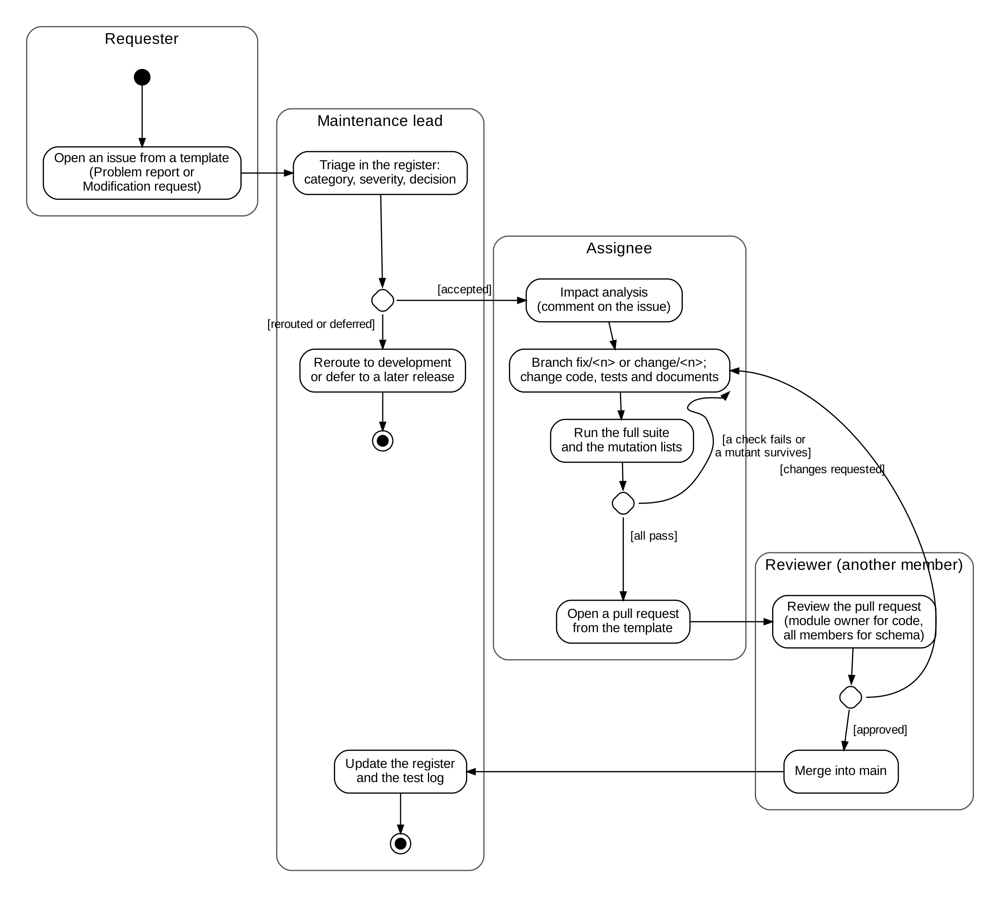

# Process definitions

Community Issue Reporting System, Group 2, CSCI 841. Defined in Version 8 of the proposal (Section 12.1, SWEBOK Chapter 8, Software Engineering Process). Process lead: Pichponleur Pen. First version: 3 November 2026.

This file is a configuration item. It changes only through a pull request, like the maintenance plan (`docs/maintenance-plan.md`, section 6).

## 1. Our three main processes

| Element | Version process (the proposal) | Change process (code and documents) | Release process |
|---|---|---|---|
| Purpose | Produce each version of the proposal, which applies one SWEBOK chapter to our project | Make one requested change to `main` without breaking the system | Deliver a tested and audited baseline of the system |
| Input | The version instructions on Blackboard, the SWEBOK chapter, and the feedback on the last version | A problem report or a modification request, opened from an issue template | The requests planned for the release in section 5 of the maintenance plan |
| Entry criteria | The leader has split the chapter by subtopic and sent each member a brief | The request is triaged in the register and has an impact analysis comment | Every planned request is merged, and a trial merge has shown no conflicts |
| Activities and tasks | Read the chapter; write and type your own subsections from your own account, with evidence from GitHub; fill in your row of the contributions table; final edit of format, numbering, front page and references; submit on Blackboard | Branch as `fix/<issue>-short-name` or `change/<issue>-short-name`; change the code, tests and documents together; run `php tests/run_tests.php` and the mutation lists; open a pull request from the template; review by another member; merge; update the register and the test log | Run the full suite on the release commit; audit the release (functional and physical) and record it in an issue; update the register and the test log; push the tag; publish the release notes on GitHub; tell the team |
| Output | A new proposal version and its contributions table | A merged change, an updated register and a test log entry | A tag that never moves (`Version.1`, `v1.1`), a GitHub release with notes, and an audit record (#20 for v1.1) |
| Exit criteria | Every subtopic of the chapter is covered or marked as not applicable with a reason, every claim matches GitHub, and the leader submits before the deadline | All checks pass, every mutant is killed, and a member other than the author approves the pull request | The audit is accepted, and every finding is planned for the next release |
| Roles | Leader (planner and final editor), section writers, and the professor as reviewer | Requester, maintenance lead (triage), assignee, reviewer, and the team as change control board | SCM lead (register and tag), release manager (release notes) and auditor (a member who did not make the changes) |
| Measures | Subsections delivered on time; feedback on each member's part; corrections needed at the final edit | Time from request to close; checks passed; mutants killed; changes with an approving review | Planned requests delivered; release date against the target; audit findings |
| Defined in | This file and the brief for each version | Section 4 of the maintenance plan, and the diagram below | Sections 5 and 6 of the maintenance plan |

## 2. The change process as a UML activity diagram



The source is `change-process.dot` (Graphviz). After a change to the source, render the picture again with:

```
dot -Tpng -Gdpi=220 docs/change-process.dot -o docs/change-process.png
```

## 3. Counting rules for the process measures

Every value in the dashboard (section 4) is counted with these rules, so that the values of different versions can be compared.

- **Change to main:** one commit in the first parent history of `main` (`git log --first-parent main`). The merge commit of a GitHub pull request is a change through a pull request; any other commit is a direct change.
- **Approving review:** a GitHub review in the state Approved, by a member other than the author, submitted before the merge. A comment, a chat message or a fix commit by the reviewer does not count.
- **Time from request to close:** from the creation of the issue to its closing, from the GitHub timestamps, in days with one decimal.
- **Check:** one PASS or FAIL line printed by a test script. The total is the last line of `php tests/run_tests.php`.
- **Mutant killed:** the full suite fails when the mutant is applied (`bash tests/mutation/mutate.sh tests/mutation/*.txt`).
- **Planned request delivered:** a request listed for the release in section 5 of the maintenance plan and closed by a pull request merged before the tag.
- **Audit finding:** a problem recorded in the audit issue of a release.

## 4. Dashboard

The leader reports these values at each proposal version (Section 12.5 of the proposal). Limits come from the rules and targets in our plans.

| Date | Checks passing | Mutants killed | Changes to main through a pull request since 23 Oct | Merged pull requests with an approving review since 23 Oct | Average time from request to close (v1.1) |
|---|---|---|---|---|---|
| 3 Nov 2026 | 244 of 244 (v1.1) | 69 of 69 (v1.1) | 5 of 7 | 3 of 5 | 3.5 days |
